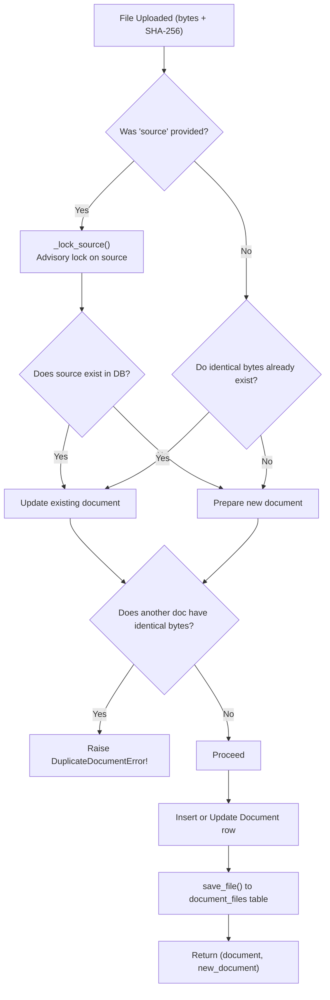

# Document Ingestion Request & Identity Resolution

**Source file reference:** [`src/ai_service/services/ingest_request.py`](../../src/ai_service/services/ingest_request.py)

This module handles what `POST /ingest` executes before background workers take over (Day 11, Task 1). It governs document identity, duplicate detection, concurrency locks, and raw binary file storage.

---

## 1. PostgreSQL Advisory Locks (`_lock_source`, Lines 49–56)

```python
async def _lock_source(session: AsyncSession, tenant_id: uuid.UUID, source: str) -> None:
    """Two requests for the same new source must not both create a document. There is no row
    to lock yet, so PostgreSQL gets an advisory lock until the transaction ends."""
    if session.get_bind().dialect.name == "postgresql":
        await session.execute(
            text("select pg_advisory_xact_lock(hashtextextended(:key, 0))"),
            {"key": f"ingest:{tenant_id}:{source}"},
        )
```

### The Problem It Solves
When a client uploads a file with a specific `source` (e.g. `source="api-docs/v1/auth.md"`):
- The API checks if a document with that source already exists for this tenant.
- If two parallel requests arrive simultaneously for a **new** source, both see that no row exists, and both try to `INSERT` a new `Document`.
- **Row-level locks (`SELECT ... FOR UPDATE`) cannot be used** because the row does not exist in the database yet.

### The Advisory Lock Solution
- **`pg_advisory_xact_lock(...)`**: Transaction-level advisory lock. PostgreSQL automatically holds the lock for the duration of the current transaction and **releases it automatically on commit or rollback**.
- **`hashtextextended(:key, 0)`**: Built-in PostgreSQL function converting the string key into a 64-bit integer (`bigint`).
- **`key: f"ingest:{tenant_id}:{source}"`**: Scoped by `tenant_id` to guarantee strict multi-tenant isolation (Tenant A never blocks Tenant B).
- **SQLite check**: Skipped on SQLite (`dialect.name == "postgresql"`) so fast unit tests run without error.

---

## 2. Document Identity Resolution & Storage (`save_document_file`, Lines 130–173)

```python
async def save_document_file(
    session: AsyncSession,
    *,
    tenant_id: uuid.UUID,
    filename: str,
    data: bytes,
    content_type: str | None,
    title: str | None = None,
    source: str | None = None,
) -> tuple[Document, bool]:
```

### The Workflow



### Detailed Breakdown

1. **SHA-256 Check (`same_bytes`):**
   - Queries if the tenant already owns any document with the exact same byte hash:
     ```python
     mine = select(Document).where(Document.tenant_id == tenant_id)
     same_bytes = await session.scalar(mine.where(Document.content_hash == sha256))
     ```

2. **Branch A: User provided an explicit `source` (Lines 133–142):**
   - Acquires the advisory lock (`_lock_source`).
   - If a document with `Document.source == source` already exists, we are replacing/updating it.
   - **Duplicate Content Guard:** If a document with the exact same SHA-256 hash already exists under a *different ID*, it raises `DuplicateDocumentError(same_bytes.id)`. A tenant cannot store identical file copies under multiple names.

3. **Branch B: No `source` provided (Line 144):**
   - Content hash is identity: reuses `same_bytes` if found; otherwise creates a brand-new document.

4. **Inserting or Updating `Document` (Lines 146–158):**
   - If new: creates a `Document` with initial metadata and placeholder `content=""` (filled by background workers during parsing).
   - If existing: updates `document.content_hash = sha256`.

5. **Metadata Merge & Flush (Lines 159–163):**
   - Merges `byte_size`, `content_type`, and `given_title` into the JSONB metadata column.
   - Calls `await session.flush()` so that `document.id` (UUID) is generated without committing the transaction.

6. **Raw Binary Persistence (`save_file`, Lines 165–173):**
   - Saves raw file bytes (`bytea`) into the `document_files` table linked to `document.id`.
   - Ensures the original file can be re-parsed or re-chunked anytime without requesting the user to upload it again.
