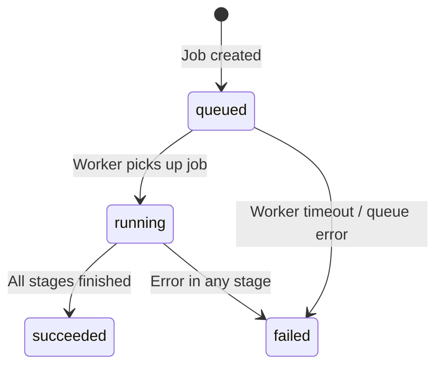

Analyzed ingestion_job.py:L1-61

The **`IngestionJob`** model (`ingestion_job.py`) represents a **persistent background job record** in the database for document ingestion (Day 11).

In a production RAG system, ingesting a document (parsing a 50-page PDF, cleaning text, chunking, generating embeddings, and upserting vectors) is CPU and I/O heavy. Instead of blocking the client's HTTP request, the API:
1. Creates an `IngestionJob` row in Postgres (`status = "queued"`).
2. Pushes only the job `id` to the background queue (Redis / ARQ).
3. Returns `job_id` to the user so they can poll `GET /api/v1/jobs/{id}` for real-time progress.

---

### 1. Job State Machine & Pipeline Stages



#### Pipeline Stages (`stage`)
Tracks where the worker is currently operating (or where it died if failed):
1. **`fetch`**: Fetching a webpage if `source_kind == "url"`.
2. **`parse`**: Extracting text from PDF, Markdown, or raw text.
3. **`clean`**: Removing running headers, footers, ligatures, and broken hyphens.
4. **`chunk`**: Cutting text into semantic chunks with token limits.
5. **`embed`**: Generating 1024-dim vectors via Jina API.
6. **`upsert`**: Writing chunks and vectors into Postgres/pgvector and Qdrant.

---

### 2. Detailed Field Breakdown

| Column | Type | Purpose |
| :--- | :--- | :--- |
| **`id`** | `UUID` | Unique job ID (Primary Key). |
| **`tenant_id`** | `UUID` | Multi-tenant isolation (`ForeignKey("tenants.id", ondelete="CASCADE")`). |
| **`document_id`** | `UUID \| None` | Linked document (`ondelete="SET NULL"`). If a document is deleted later, the job record stays as audit history with `document_id = NULL`. |
| **`source_kind`** | `String(10)` | `"file"` (uploaded file) or `"url"` (remote web page). |
| **`source`** | `String(2048)` | The original filename (e.g. `manual.pdf`) or URL. |
| **`status`** | `String(10)` | `"queued"`, `"running"`, `"succeeded"`, or `"failed"`. |
| **`stage`** | `String(10)` | The current/failed stage (`"fetch"`, `"parse"`, `"clean"`, `"chunk"`, `"embed"`, `"upsert"`). |
| **`error`** | `String(500)` | A safe, user-friendly error message (never a raw internal stack trace). |
| **`attempts`** | `Integer` | Number of times the job was attempted (for retry policies). |
| **`chunks_written`**| `Integer` | Total chunks saved to the vector database upon completion. |
| **`started_at`** | `DateTime` | When a worker began executing the job. |
| **`finished_at`**| `DateTime` | When the job succeeded or failed. |

---

### 3. Database Integrity Constraints (`__table_args__`)

The model enforces business rules directly inside PostgreSQL with `CheckConstraint`:

1. **Enum validations:**
   - `status` must be one of `("queued", "running", "succeeded", "failed")`.
   - `stage` must be one of `("fetch", "parse", "clean", "chunk", "embed", "upsert")`.
   - `source_kind` must be one of `("file", "url")`.
2. **Error consistency constraint:**
   ```python
   CheckConstraint("(status = 'failed') = (error is not null)", name="error_when_failed")
   ```
   - If `status == 'failed'`, `error` **cannot** be null (you must record why it failed).
   - If `status != 'failed'`, `error` **must** be null (a successful or running job cannot carry an error).

---

### Why Save This in PostgreSQL Instead of Just Redis/ARQ?
- **Retention:** Redis task queues expire job results after a short TTL. PostgreSQL keeps permanent audit logs for every document ingested.
- **Multi-Tenancy:** By keeping `tenant_id` on the job table, clients can query `GET /api/v1/jobs` and only see jobs belonging to their own organization.

---

### 4. Service Layer: Status Transitions & Concurrency Architecture (`ingestion_jobs.py:1-13`)

**Source file reference:** [`src/ai_service/services/ingestion_jobs.py:1-13`](../../src/ai_service/services/ingestion_jobs.py#L1-L13)

```python
"""Creating ingestion jobs and moving them from one status to the next (Day 11).

Every change is one UPDATE that names the statuses it may start from, so the database decides:
a finished job cannot start again, and of two attempts to finish a job only one succeeds.
Each function returns False when the change was not allowed.

None of them commits. The worker commits a stage so that the status endpoint can see it, and
can commit "succeeded" in the same transaction as the chunks it saved.

This does NOT stop two workers from running the same job at the same time ("running" may
start again, because ARQ can run a job twice and a retry starts it again). Saving the chunks
has to be safe to repeat.
"""
```

#### Key Architecture Principles:

1. **Atomic State Transitions via SQL (`WHERE status IN (...)`):**
   - In distributed background systems, two workers might handle the same job concurrently. Rather than checking statuses in Python (`if job.status == 'running'`) which creates race conditions, transitions are handled directly in an atomic SQL `UPDATE`:
     ```sql
     UPDATE ingestion_jobs
     SET status = 'succeeded', ...
     WHERE id = :job_id AND status IN ('running');
     ```
   - PostgreSQL decides concurrency. If the job was already finished or cancelled, `rowcount` is `0`, and the service function returns `False`.

2. **Caller-Managed Transactions (`None of them commits`):**
   - Service functions never call `await session.commit()`.
   - Transaction boundary control belongs to the background worker.
   - This guarantees atomicity: when an ingestion job finishes, the worker writes all generated chunks into the `chunks` table **and** updates the job status to `succeeded` in the **exact same database transaction**. If saving chunks crashes, the status update rolls back automatically.

3. **Queue Re-deliveries & Idempotency:**
   - Queues like Redis/ARQ guarantee **at-least-once delivery**, meaning a job may occasionally re-trigger or retry.
   - `start_job()` allows transitioning from both `queued` and `running` $\rightarrow$ `running`.
   - Because of this, saving chunks to PostgreSQL / Qdrant must always be **idempotent** (e.g. `ON CONFLICT (document_id, chunk_index) DO UPDATE`), ensuring re-running the job never duplicates chunks.
