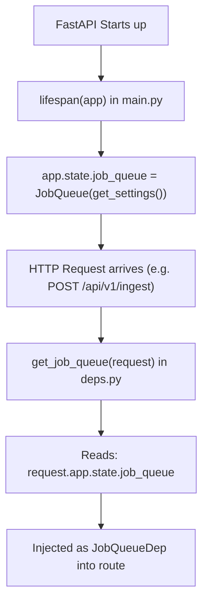

# Job Queue Architecture & Lifecycle

**Source file references:**
- [`src/ai_service/services/job_queue.py`](../../src/ai_service/services/job_queue.py)
- [`src/ai_service/main.py:26–45`](../../src/ai_service/main.py#L26-L45)
- [`src/ai_service/api/deps.py:97–103`](../../src/ai_service/api/deps.py#L97-L103)

---

## 1. How `job_queue` Reaches `app.state` (`deps.py:99`)



1. **Lifespan Initialization (`main.py`):**
   ```python
   @asynccontextmanager
   async def lifespan(app: FastAPI) -> AsyncGenerator[None]:
       # ...
       app.state.job_queue = JobQueue(get_settings())
       try:
           yield
       finally:
           await app.state.job_queue.aclose()
   ```
   - Instantiated once per application process.
   - Closed cleanly during shutdown (`aclose()`).

2. **Dependency Injection (`deps.py`):**
   ```python
   def get_job_queue(request: Request) -> JobQueue:
       queue: JobQueue = request.app.state.job_queue
       return queue

   JobQueueDep = Annotated[JobQueue, Depends(get_job_queue)]
   ```
   - In automated tests, Redis can be swapped out with a fake queue without altering application logic:
     ```python
     app.dependency_overrides[get_job_queue] = lambda: FakeJobQueue()
     ```

---

## 2. Why `self._lock = asyncio.Lock()` Is Used (Line 40)

```python
self._pool: ArqRedis | None = None
self._lock = asyncio.Lock()
```

- **Problem:** `JobQueue` connects to Redis **lazily** on the first request rather than at server boot. If 10 concurrent requests hit the server right at startup, all 10 would see `self._pool is None` and attempt to open separate Redis connection pools, leaking sockets and wasting memory.
- **Solution:** `async with self._lock` ensures only **one** coroutine creates the connection pool (`self._pool`). All other concurrent requests wait; once acquired, `self._pool is None` is `False`, skipping pool creation instantly.

---

## 3. Explaining `enqueue_ingestion` (Lines 39–48)

```python
async def enqueue_ingestion(self, job_id: uuid.UUID) -> bool:
    async with self._lock:
        if self._pool is None:
            connect = redis_settings(self._url)
            # a user is waiting: fail fast (ARQ's default tries five more times)
            connect.conn_retries = 1
            connect.conn_timeout = 2
            self._pool = await create_pool(connect, default_queue_name=QUEUE_NAME)
    async with asyncio.timeout(5):
        return await enqueue_ingestion(self._pool, job_id)
```

1. **Fail-Fast Connection (`conn_retries = 1`, `conn_timeout = 2`):**
   - ARQ's default tries 5 times with exponential backoff if Redis is unreachable (which would freeze an HTTP request for 15–30s).
   - This configuration fails in **2 seconds**, quickly notifying the user if Redis is offline.
2. **5-Second Deadline (`async with asyncio.timeout(5):`):**
   - Sets a hard deadline on pushing the message to Redis so client requests never hang indefinitely if Redis is stalled.
3. **Execution Outside Lock:**
   - Notice that enqueuing (`enqueue_ingestion(self._pool, job_id)`) happens **outside the lock**. The lock is only held during the one-time pool creation; all subsequent enqueuing runs in parallel.
4. **Return Value:**
   - **`True`**: The job was successfully placed into the Redis queue (`"ai-service:jobs"`).
   - **`False`**: Deduplication prevented re-enqueueing because this exact job is already waiting or finished recently.

---

## 4. Why the Class Method and Standalone Function Share the Same Name

In `job_queue.py`:
- `JobQueue.enqueue_ingestion(self, job_id: uuid.UUID) -> bool` (Class method, line 39)
- `enqueue_ingestion(queue: ArqRedis, job_id: uuid.UUID) -> bool` (Standalone function, line 55)

### Comparison Table: Separation of Concerns

| | The Class Method (`JobQueue.enqueue_ingestion`) | The Standalone Function (`enqueue_ingestion`) |
| :--- | :--- | :--- |
| **Role** | **Manager / Orchestrator** | **Worker / Pure Executor** |
| **What it owns** | Redis connection pool (`self._pool`), locks (`self._lock`), and timeouts (`asyncio.timeout(5)`). | Just sends bytes to Redis via an existing connection. |
| **What it receives** | Only `(self, job_id)` | `(queue: ArqRedis, job_id)` |
| **Logic** | Checks connection, acquires mutex lock, sets 5s timeout, delegates. | Calls `queue.enqueue_job(...)`. |

```python
# The Class Method:
async def enqueue_ingestion(self, job_id: uuid.UUID) -> bool:
    # 1. Manage connection & lock
    async with self._lock:
        ...
    # 2. Manage timeout and DELEGATE to the standalone function
    async with asyncio.timeout(5):
        return await enqueue_ingestion(self._pool, job_id)
```

### Benefits
1. **Namespace Separation:** In Python, methods on an instance (`job_queue.enqueue_ingestion`) and module-level functions (`enqueue_ingestion(...)`) do not collide.
2. **Semantic Clarity:** Both perform the exact same logical operation; the method simply delegates to the function.
3. **Testability & Scripts:** In CLI tools, migrations, or test fixtures where a raw Redis connection already exists, you can call `enqueue_ingestion(test_redis, job_id)` directly without needing to construct a `JobQueue` instance or mock `Settings`.
4. **Deduplication:** The standalone function sets `_job_id=f"ingest:{job_id}"`, enabling Redis to automatically reject duplicate jobs within an hour.
