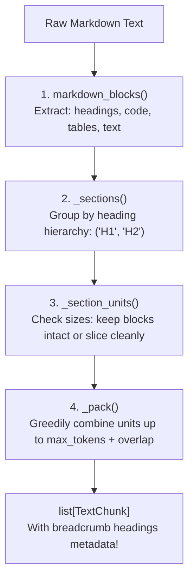

Analyzed chunking.py:L200-300
Analyzed chunking.py:L301-370

The **Markdown Chunker** (`markdown_chunks`) in `chunking.py` is a **structure-aware chunker**. 

Unlike naive chunkers that blindly cut text at token or character limits, this chunker understands Markdown syntax (headings, code blocks, tables, and paragraphs) and preserves document meaning.

---

### The 4-Stage Pipeline



---

### 1. Block Extraction (`markdown_blocks`)
Line 243: The parser reads line-by-line and groups continuous text into 4 kinds of blocks:
- **`"code"`**: Fenced code blocks (``` or `~~~`). 
  > **Key detail:** It tracks whether it is currently inside a code fence. A `#` inside a Python or bash code block is treated as code, **never** mistaken for a Markdown heading.
- **`"heading"`**: Lines starting with `#{1,6}`. It extracts the heading level (1 to 6) and cleans out anchor tags like `{#id}` or `<a name=...>`.
- **`"table"`**: Markdown pipe tables (lines starting with `|`).
- **`"text"`**: Standard paragraphs.

---

### 2. Hierarchical Sections (`_sections`)
Line 291: Assembles blocks under their heading hierarchy.
- Maintains a breadcrumb stack of headings:
  ```markdown
  # System Architecture        -> ("System Architecture",)
  ## Storage Layer             -> ("System Architecture", "Storage Layer")
  ### PostgreSQL               -> ("System Architecture", "Storage Layer", "PostgreSQL")
  ```
- **Golden rule:** **A chunk never mixes text across different sections.** Each section is handled as an independent boundary.

---

### 3. Section Unit Splitting (`_section_units`)
Line 312: For each section:
1. **Fits entirely?** If the whole section is $\le$ `max_tokens`, it stays as one single piece.
2. **Too large?** It splits blocks with specialized rules:
   - **Code & Tables**: Kept whole if possible. If a code snippet or table exceeds `max_tokens`, it is cut **only between line breaks**, never in the middle of a code statement or table row.
   - **Text**: Split at sentence or word boundaries.
3. **Heading Binding:** Keeps the heading block tied to the first paragraph beneath it so a heading is never left stranded in its own chunk.

---

### 4. Packing & Breadcrumbs (`_pack` and `markdown_chunks`)
Line 349:
- **Greedy Packing:** Neighboring units within the section are packed together up to `max_tokens`.
- **Contained Overlap:** Overlap tokens are taken from previous units, but **never bleed outside the section**.
- **Metadata Enriched:** Every returned `TextChunk` includes the `headings` tuple:
  ```python
  TextChunk(
      index=0,
      start=150,
      end=420,
      text="...",
      tokens=180,
      headings=("System Architecture", "Storage Layer")
  )
  ```

---

### Why Use It Over Plain Recursive Chunking?
1. **No Broken Code / Tables:** Avoids splitting inside `def my_function():` or in the middle of table columns.
2. **Context Retention:** Chunks retain their heading breadcrumbs (`headings`), which can be indexed or prepended to chunk embeddings to give the vector search model explicit semantic context.
3. **Zero Leaks Across Topics:** Content from "Section B" never gets merged into a chunk belonging to "Section A".